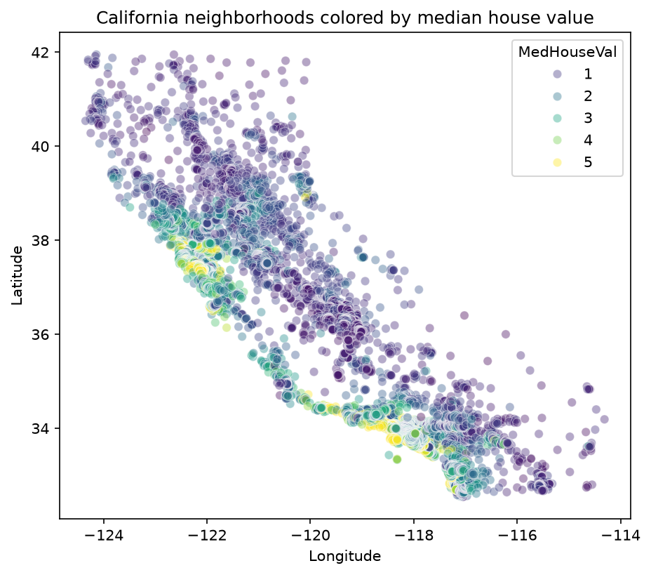

# House Price Predictor

## Problem
Predict the median house value of a California neighborhood from census features
such as median income, house age, and location. This is a supervised **regression** problem.

## Data
- Source: California housing dataset from scikit-learn (`fetch_california_housing`), based on the 1990 census.
- 20,640 rows, each a neighborhood (census block group), with 8 features and 1 target (`MedHouseVal`, in units of $100,000).
- No missing values or duplicates.

## What I've done so far
- Completed exploratory data analysis (see `01-eda.ipynb`).
- Key findings:
  - Median income has the strongest correlation with price (0.69).
  - Target values are capped at $500,000 (992 rows, about 5%), so models will likely underpredict the most expensive areas.
  - Some features (`AveRooms`, `AveOccup`) contain extreme outliers.
  - Location has a strong non-linear effect on price: coastal areas are most expensive, though latitude and longitude show weak linear correlations.

## Next steps
- Decide how to handle outliers and capped rows.
- Build and evaluate a baseline regression model.